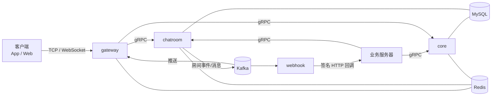

# orbikit

**orbikit 是一套用 Go 编写的分布式实时房间服务端**，面向语聊房、直播间、互动课堂等"房间型"场景。它不只提供 IM 消息通道，还内置了房间、成员、角色、麦位、机器人、排行等业务能力，并通过 webhook 和 gRPC 接口把业务扩展点开放给你的业务服务器。

> 状态：v0.1 开发中。核心链路已可编译、可部署，接口仍可能调整。

## 特性

- **长连接网关**：TCP 与 WebSocket 双接入，同一套 20 字节包头 + protobuf 协议；TCP 可选 xxtea 包体加密，WebSocket 建议配合 wss。
- **水平扩展**：网关无状态，跨节点推送经 Kafka 广播；服务间 gRPC 支持 `dns:///` 客户端负载均衡，可直接跑在 docker compose / Kubernetes 上。
- **房间业务**：创建/开关房间、进出房、在线列表、踢人/拉黑/禁言（到期自动解除）、自定义角色、麦位（上麦/下麦/邀请/锁麦/禁麦）、机器人、在线人数与麦位排行、在线时长统计。
- **多租户**：一套部署服务多个应用（appId / appSecret），应用间数据隔离。
- **业务扩展**：
  - **消息抄送 webhook**：房间消息、自定义消息、房间事件按应用配置签名后 POST 到业务服务器，支持按应用、按消息类型限流和失败重试。
  - **可插拔内容审核**：`none` / 本地关键词（DFA）/ 调用业务方 HTTP 审核服务。
  - **服务端 gRPC API**：业务服务器直接调用 core / chatroom 完成建房、发 token、发系统消息、管理成员等操作。

## 架构



| 服务 | 职责 | 默认端口 |
|---|---|---|
| `gateway` | 长连接接入、鉴权、命令路由、消息下发、HTTP 短连接 | TCP 8000 / WS 8001 (`/ws`) / HTTP 8080 |
| `core` | 应用管理、登录 token 签发与校验、用户封禁 | gRPC 9001 |
| `chatroom` | 房间、成员、角色、麦位、机器人、消息，向 Kafka 生产事件 | gRPC 9002 |
| `webhook` | 消费房间消息并签名回调业务服务器 | gRPC 9004 |

## 快速开始

需要 Docker（含 compose v2）和 Go 1.22+。

```bash
git clone https://github.com/EdwinChanYi/orbikit.git
cd orbikit
make up            # 等价于 docker compose -f deploy/docker-compose.yml up -d --build
```

国内网络可以在构建时指定 Go 代理：`docker compose -f deploy/docker-compose.yml build --build-arg GOPROXY=https://goproxy.cn,direct`。

服务启动后，用 quickstart 扮演业务服务器：创建应用、签发登录 token、建房并申请进房 token：

```bash
go run ./examples/quickstart -uid 10001 -room 1001
```

它会打印一条可直接执行的命令，用 WebSocket 连上网关、进入房间并发送一条消息：

```bash
go run ./examples/gateway-client -transport ws -app <app_id> -uid 10001 \
    -token <login_token> -room 1001 -room-token <room_token> -msg hello
```

再开一个终端，用另一个 uid 重复上面两步，就能看到两个客户端互相收到房间消息。

也可以直接用浏览器。再开一个终端：

```bash
go run ./examples/web
```

打开 <http://localhost:8090>，两个浏览器窗口用不同昵称进入同一个房间号即可对话。页面走的是网关的 WebSocket 协议，`examples/web` 只负责创建应用、签发令牌。

协议和架构说明在 [docs/protocol.md](docs/protocol.md)、[docs/architecture.md](docs/architecture.md)。

## 消息抄送 webhook

在应用上配置回调地址（`msg_cp_url` 房间事件、`text_cp_url` 文本消息、`custom_cp_url` 自定义消息）后，webhook 服务会把对应消息以 `POST application/json` 发送过去，请求头：

| Header | 说明 |
|---|---|
| `App-Id` | 应用 ID |
| `Nonce` | 64 位随机串 |
| `Cur-Time` | Unix 时间戳（秒） |
| `Check-Sum` | `hex(sha1(AppSecret + Nonce + Cur-Time + 请求体))`，小写十六进制，直接拼接无分隔符 |

业务服务器用同样的方式计算并比对 `Check-Sum` 即可校验来源。网络错误、HTTP 429 和 5xx 会按配置指数退避重试；投递语义为"至多一次"。

## 目录结构

```text
api/proto/        protobuf 定义（client：客户端协议；service：服务间 gRPC）
api/gen/          buf 生成的 Go 代码（make proto）
cmd/<service>/    各服务入口
internal/<svc>/   各服务实现
pkg/              公共组件：配置、日志、Redis、Kafka、MySQL、gRPC、ID 生成
configs/          本机运行的示例配置（localhost）
deploy/           docker compose 及其配置
examples/         gateway-client 命令行客户端、quickstart、浏览器 demo
docs/             架构与协议说明
```

## 本地开发

```bash
make build         # 编译全部服务到 bin/
make test          # go test -race ./...
make lint          # go vet + golangci-lint
make tools proto   # 安装 buf 与插件并重新生成 api/gen
```

本机直接运行服务时使用 `configs/*.yaml`，例如 `go run ./cmd/core -config configs/core.yaml`。密码等敏感项通过 `${MYSQL_PASSWORD}`、`${REDIS_PASSWORD}` 等环境变量注入。

## 路线图

- [x] 协议与架构文档
- [x] Web 端 demo（WebSocket + protobuf）
- [x] 应用配置变更改为 Redis 广播通知
- [ ] 历史消息存储与查询
- [ ] 对象存储抽象（恢复客户端日志上传）
- [ ] 压测报告

## 许可证

[Apache License 2.0](LICENSE)
