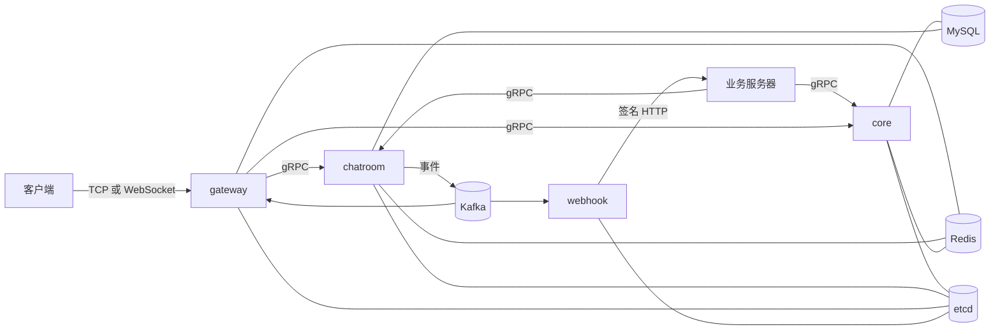

# 架构

orbikit 把一个房间型实时场景拆成四个进程。业务服务器不接入长连接，只通过 gRPC 管应用和房间，通过 webhook 收消息。

## 进程

| 进程 | 做什么 | 不做什么 |
|---|---|---|
| gateway | 维持客户端连接，校验登录令牌，把命令转成对 core / chatroom 的 gRPC，把 Kafka 里的事件推回在线连接 | 不保存房间状态 |
| core | 应用（appId / appSecret）、登录令牌、封禁 | 不感知房间 |
| chatroom | 房间、成员、角色、麦位、机器人、消息，结果写入 MySQL / Redis，并把需要下发的事件写入 Kafka | 不直接碰客户端连接 |
| webhook | 消费房间广播，按应用配置签名后 POST 给业务服务器 | 不产生房间状态 |

依赖是 MySQL、Redis、Kafka、etcd。`deploy/docker-compose.yml` 用一套单机把它们和四个进程拉起来。

## 一次发消息经过哪里

1. 业务服务器调用 core 的 `ApplyClientLoginToken` 拿到登录令牌，交给客户端。
2. 客户端连上网关，发 `AUTH`。网关用令牌向 core 换出 appId 和 uid，并在 Redis 记下这台网关持有该连接。同一用户的新连接会把旧连接踢下线。
3. 业务服务器调用 chatroom 的 `CreateChatroom`、`ApplyEnterChatroomToken`。客户端发 `CHATROOM_ENTER`，网关转给 chatroom。
4. 客户端发 `CHATROOM_SEND_MESSAGE`。网关可选地做内容审核，然后调用 chatroom 的 `SendChatroomMsg`。
5. chatroom 把 `ChatroomBcst` 写入 `orbikit.room.broadcast`。每台网关用自己唯一的消费组读到它，只推给本机上、且在这个房间里的连接。
6. webhook 用共享消费组读同一条消息，按应用登记的地址回调业务服务器。投递是至多一次：队列满或重试耗尽就丢弃并记日志。

踢人、关房走 `orbikit.room.kicked`。全服广播走 `orbikit.room.fullserver`。封禁走 `orbikit.room.event`，网关收到后断开该用户。

## 状态放在哪

- MySQL：应用、房间资料、成员资料、角色、机器人、在线时长。启动时 `AutoMigrate` 建表。
- Redis：在线连接、登录令牌、房间在线集合、禁言和踢人的过期键、麦位、排行。禁言到期和断线超时依赖键过期通知，Redis 需要 `notify-keyspace-events Ex`。
- 进程内存：core 和 webhook 会缓存应用配置，默认 60 秒。

应用配置一旦变更，core 往 Redis 频道 `orbikit:app_config` 发一条 `AppInfoUpdatedRequest`。所有 core 实例据此丢掉本地缓存，所有 webhook 实例据此更新抄送地址和限流。这样增加实例不用再改一份地址清单。这个频道是普通 pub/sub，在 Redis Cluster 里只在单个节点内传播，集群部署时要让发布和订阅落在同一节点，或者就用单机 Redis。

## 水平扩展

- 网关无状态。每个实例的 `kafka.group_id` 必须不同（留空会自动生成），否则会漏推送。
- webhook 共用一个消费组，一条消息只被一个实例回调。
- core、chatroom、webhook 启动后把自己登记到 etcd，键是 `/orbikit/services/<服务名>/<实例>`，值是其他进程能访问的 `host:port`。租约默认 10 秒并自动续期，进程退出时立刻删除。调用方把地址写成 `etcd:///core` 这样的服务名，gRPC 在当前存活的实例之间轮询。`register.advertise_addr` 留空时，用通向 etcd 的本机地址，这样多副本不会登记成同一个名字。chatroom 多实例时，每个实例都会收到同一条 Redis 过期事件并各广播一次，处理本身是幂等的。
- 不配置 `etcd.endpoints` 时不注册，调用方继续使用 `host:port` 直连。`configs/*.yaml` 是这条路径，方便本机单个进程调试。`deploy/configs` 走 etcd。

## 业务扩展点

- **gRPC**：`api/proto/service` 里的 `Core` 和 `Chatroom`。建房、发令牌、踢人、发系统消息都从这里进。
- **消息抄送**：应用上的 `text_cp_url`、`custom_cp_url`、`msg_cp_url`。签名算法见 [协议](protocol.md)。
- **内容审核**：网关配置 `moderation.type`，可选不审核、本地词库、或调用业务方的 HTTP 接口。

## 还没做

- 历史消息的存储和查询。对应命令会返回不支持。
- 客户端日志上传。原来依赖对象存储，接口目前返回 Unimplemented。
- 单聊。协议里留了会话类型，服务端只实现了房间。
